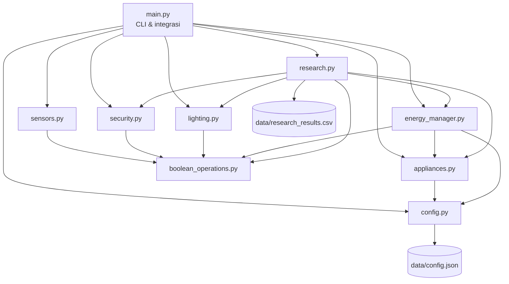
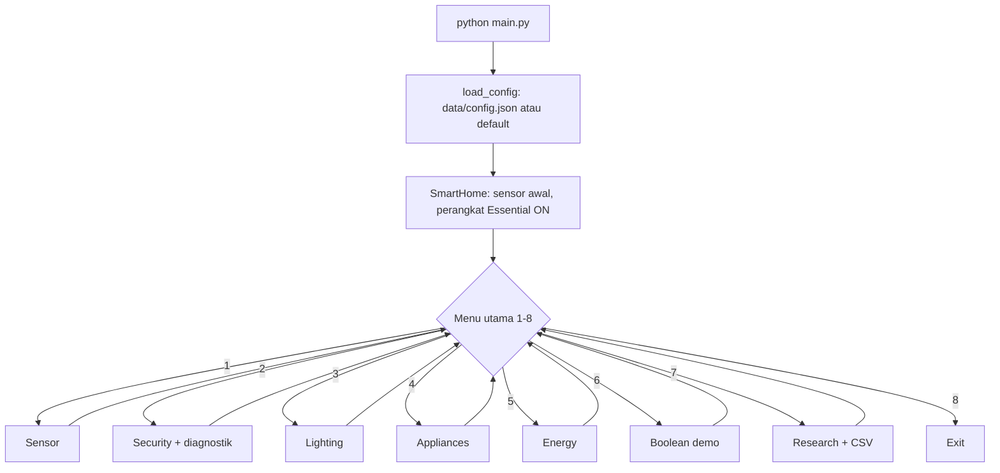
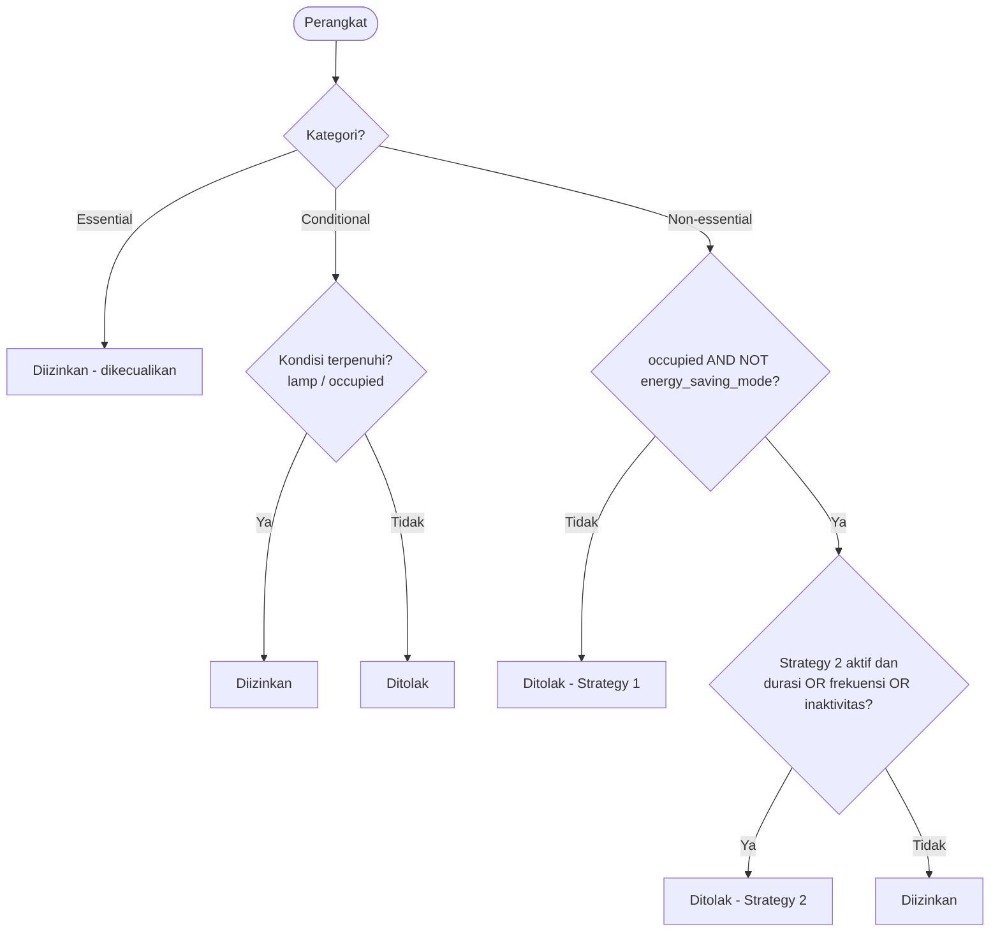

# Software Architecture

## 1. Struktur Direktori

```text
smart-home-automation/
├── main.py                 # entry point CLI, menu, integrasi
├── config.py               # kategori, daftar perangkat, daya, batas, load/save JSON
├── boolean_operations.py   # AND OR NOT XOR NAND NOR + tabel kebenaran
├── sensors.py              # SensorState, parse input, diagnostik XOR/NOR/NAND
├── security.py             # alarm_active = security_mode AND (door_open OR motion_detected)
├── lighting.py             # AUTO / ON / OFF, lamp_on = occupied AND dark
├── appliances.py           # status perangkat + penghitung waktu simulasi
├── energy_manager.py       # Strategy 1 & 2, keputusan boleh/tidak, kalkulasi kWh
├── research.py             # Experiment 1-3, simulasi sehari, ekspor CSV
├── data/config.json        # konfigurasi (daya & batas penggunaan dapat diubah)
├── data/research_results.csv
├── tests/                  # 5 file unittest (53 test)
├── tools/generate_line_guide.py   # pembuat LINE_BY_LINE_GUIDE (penyimpangan dari rancangan awal)
└── docs/
```

**Penyimpangan dari rancangan awal (dengan alasan):** ditambahkan `tools/generate_line_guide.py` dan `tests/__init__.py`.
Alasannya: panduan baris-demi-baris harus cocok dengan nomor baris kode final; membuatnya otomatis dari AST
mencegah ketidaksesuaian saat kode berubah. `tests/__init__.py` kosong membuat `unittest discover -s tests` dapat mengimpor folder.

## 2. Fungsi dan Hubungan Antar Modul



Aturan ketergantungan: `boolean_operations.py` tidak mengimpor modul proyek lain (lapisan paling bawah);
`config.py` hanya bergantung pada Standard Library; `appliances.py` tidak memutuskan kebijakan; semua keputusan
izin ada di `energy_manager.py`; hanya `main.py` yang berinteraksi dengan pengguna (`input`/`print` interaktif).
Tidak ada ketergantungan melingkar.

## 3. Alur Data

1. Pengguna mengubah nilai sensor di `main.py` → disimpan pada `SensorState` (bool).
2. `security.evaluate_security` dan `lighting.evaluate_lighting` menghitung `alarm_active` dan `lamp_on`.
3. `SmartHome.context()` membentuk `Context(occupied, energy_saving_mode, lamp_on)`.
4. `energy_manager.evaluate_device` mengonversi data numerik (menit, aktivasi, idle) menjadi Boolean, lalu memutuskan.
5. `SmartHome.refresh()` menyelaraskan perangkat (Main Lighting mengikuti lampu; `enforce_policy` mematikan yang tidak diizinkan).
6. `research.py` menjalankan logika yang SAMA pada profil sehari dan menulis CSV.

## 4. Alur Eksekusi



### Flowchart keputusan perangkat (`evaluate_device`)



## 5. Alasan Arsitektur Modular

- **Satu tanggung jawab per file:** perubahan aturan alarm tidak menyentuh kode energi.
- **Mudah diuji:** fungsi murni (mis. `evaluate_security`) diuji tanpa CLI atau waktu nyata.
- **Mudah dijelaskan:** anggota kelompok dapat mempelajari satu modul pada satu waktu.
- **Konsistensi logika:** seluruh operasi Boolean berasal dari `boolean_operations.py`.
- **Reproduktif:** `research.py` memakai logika sistem yang sama sehingga hasil simulasi mencerminkan implementasi, bukan salinan terpisah.
